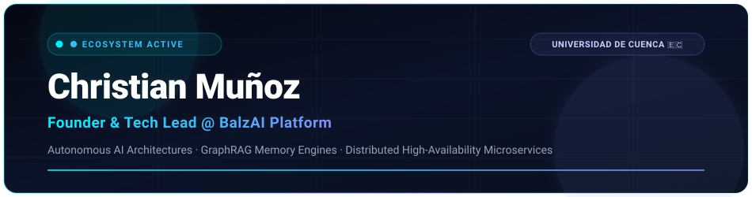

 

  
  
  

---

### ⚡ Engineering Bento Grid

<table>
  <tr>
    <td width="60%" valign="top">
      <h4>🎯 Perfil &amp; Liderazgo Técnico</h4>
      

        <b>Fundador y Líder Técnico</b> del ecosistema <b>BalzAI</b> (Universidad de Cuenca). Especializado en diseño de arquitecturas para <b>orquestación multi-agente</b>, memoria relacional a largo plazo (<b>GraphRAG</b>) y microservicios transaccionales con alta disponibilidad.
      

      <ul>
        <li>🎓 <b>Alma Mater:</b> Universidad de Cuenca, Ecuador 🇪🇨</li>
        <li>🧠 <b>Enfoque:</b> Sistemas Autónomos, Memoria de Grafo y Reducción de Tokens (&gt;98%).</li>
        <li>🛡️ <b>Estándares:</b> Clean Architecture, DDD, Seguridad OWASP Top 10 y Tipado Estricto.</li>
      </ul>
    </td>
    <td width="40%" valign="top">
      <h4>📊 Métricas de Sistema</h4>
      <ul>
        <li>🚀 <b>Uptime:</b> 99.99% en Servidores de Producción</li>
        <li>🔄 <b>Despliegue:</b> Zero-Downtime Reload con PM2</li>
        <li>⚡ <b>Eficiencia:</b> &gt;98.5% Ahorro de Tokens en LLMs</li>
        <li>📦 <b>Microservicios:</b> 4 Puertos Aislados (:3200, :3000, :8000, :3300)</li>
      </ul>
    </td>
  </tr>
</table>

---

### 🛠️ Arsenal Tecnológico

#### 🌐 Frontend & Experiencia Visual

  

#### ⚙️ Backend, APIs & Microservicios

  

#### 🧠 Inteligencia Artificial, Grafos & Persistencia

  

  
  
  
  
  

#### 🛡️ DevOps, Sistemas & Control de Versiones

  

---

### 🚀 Ecosistema de Plataformas & Proyectos

<table>
  <tr>
    <td width="50%" valign="top">
      <h4>🌐 <a href="https://github.com/ytAdrianGT/BalzAI">BalzAI Platform</a></h4>
      
Orquestador multi-agente con memoria de grafo relacional en Neo4j y Parquet, reduciendo más del 98% el consumo de tokens en tareas complejas.

      
<code>Next.js 15</code> · <code>FastAPI</code> · <code>Neo4j 5.26</code> · <code>GraphRAG</code>

    </td>
    <td width="50%" valign="top">
      <h4>🏢 <a href="https://github.com/ytAdrianGT/Startup-BalzAI">Startup BalzAI (Producción)</a></h4>
      
Hub central de producción con balanceo de procesos en PM2, arquitectura monorepo desacoplada y despliegue quirúrgico zero-downtime.

      
<code>PM2 Cluster</code> · <code>Microservicios</code> · <code>Zero-Downtime</code> · <code>Docker</code>

    </td>
  </tr>
  <tr>
    <td width="50%" valign="top">
      <h4>🚗 <a href="https://github.com/ytAdrianGT/Startup-BalzAI">FlashPark IoT</a></h4>
      
Plataforma de estacionamientos inteligentes con telemetría en tiempo real, mapas interactivos con Leaflet e ingesta de sensores IoT.

      
<code>React 19</code> · <code>Vite</code> · <code>FastAPI</code> · <code>Leaflet Maps</code>

    </td>
    <td width="50%" valign="top">
      <h4>🏥 <a href="https://github.com/ytAdrianGT/Startup-BalzAI">Dermatología Clínica</a></h4>
      
Sistema clínico de citas médicas y trazabilidad de inventario farmacéutico con transacciones ACID, integridad referencial y RBAC.

      
<code>Next.js 15</code> · <code>App Router</code> · <code>SQLite</code> · <code>RBAC</code>

    </td>
  </tr>
</table>

---

### 📊 Telemetría de Actividad & GitHub Stats

  

---

