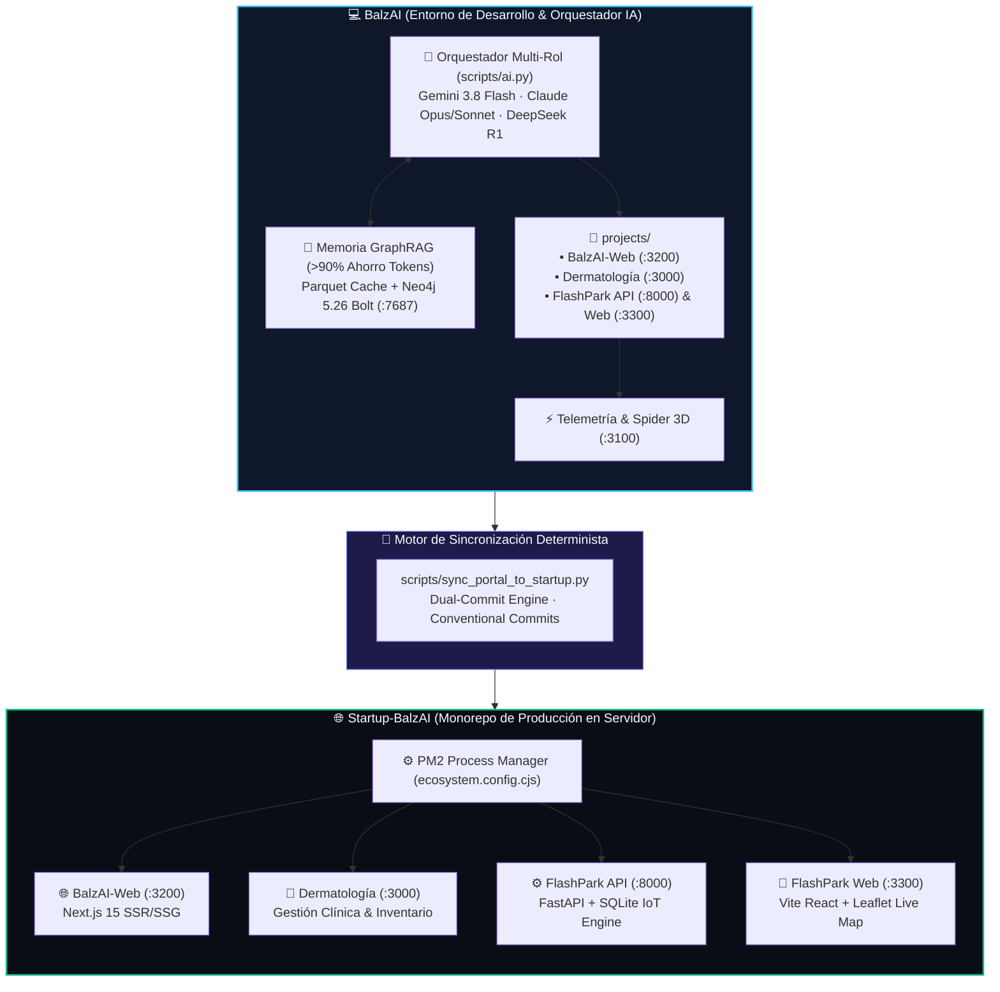

<div align="center">

# ⚡ BalzAI Platform
### Ecosistema Multi-Agente Concurrente, Memoria GraphRAG y Monorepo de Servicios Distribuidos

[](https://nextjs.org/)
[](https://react.dev/)
[](https://fastapi.tiangolo.com/)
[](https://www.typescriptlang.org/)
[](https://neo4j.com/)
[](https://ollama.ai/)
[](https://pm2.keymetrics.io/)
[](#)

<p align="center">
  <b>Una plataforma de ingeniería de nueva generación nacida en la Universidad de Cuenca</b><br>
  Optimizada para <b>desarrollo acelerado asistido por IA</b> con retención de memoria de grafo a largo plazo (GraphRAG), ahorro superior al <b>98% en tokens de contexto</b> y sincronización determinista hacia servidores de producción de alta disponibilidad.
</p>

---

</div>

## 📊 Métricas de Ingeniería & Rendimiento

<div align="center">

| 🧠 Eficiencia GraphRAG | 🚀 Tiempo de Inactividad | 🛡️ Ciberseguridad | 🔌 Arquitectura |
| :---: | :---: | :---: | :---: |
| **>98.5%** | **0 ms** | **OWASP Top 10** | **4 Microservicios** |
| Reducción de tokens de contexto vía Parquet & Neo4j | Zero-Downtime Reload selectivo con PM2 | Criptografía PBKDF2-SHA512 y SQL parametrizado | Puertos dedicados y desacoplamiento total |

</div>

---

## 🏛️ Topología de la Plataforma



---

## 🌐 Catálogo de Servicios & Puertos Estandarizados

Cada aplicación cuenta con aislamiento de procesos y puertos definidos contractualmente:

| Servicio | Puerto Local | Stack Tecnológico | Rol en el Ecosistema | Estado |
| :--- | :---: | :--- | :--- | :---: |
| **BalzAI Web** | [`:3200`](http://localhost:3200) | Next.js 15 · React 19 · TailwindCSS | Portal corporativo oficial y vitrina comercial | `● OPERATIONAL` |
| **Dermatología** | [`:3000`](http://localhost:3000) | Next.js 15 · App Router · SQLite | Sistema de citas clínicas y control de stock médico | `● OPERATIONAL` |
| **FlashPark API** | [`:8000`](http://127.0.0.1:8000/docs) | FastAPI · Python 3.11 · SQLite · JWT | Ingesta de sensores IoT y backend transaccional | `● OPERATIONAL` |
| **FlashPark Web** | [`:3300`](http://localhost:3300) | React 19 · Vite · Leaflet Maps | Mapa de parqueo en vivo y consola SuperAdmin | `● OPERATIONAL` |
| **Telemetría & 3D** | [`:3100`](http://localhost:3100) | Python HTTP · Spider Graph 3D | Trazabilidad de agentes y monitoreo de cuotas | `● LOCAL ONLY` |
| **Neo4j Graph DB** | [`:7474`](http://localhost:7474) | Docker Neo4j 5.26 Community | Base de grafos de conocimiento empresarial | `● PERSISTENT` |
| **Ollama Local** | [`:11434`](http://localhost:11434) | Qwen 2.5 Coder 16k · Nomic Embed | Inferencia local sin costo ni límites de cuota | `● $0 OFFLINE` |

---

## 🤖 Orquestador Multi-Agente & Política de Cuotas

Para maximizar la productividad y no agotar cuotas semanales de modelos avanzados, BalzAI implementa una **política de orquestación escalonada**:

```
[Gemini 3.8 Flash Medium] (Modelo Base por Defecto)
         │
         ├──► [gemini-4-argon-high]  --> Arquitectura fundacional & auditoría mayor
         ├──► [claude-opus-5-5-high] --> Ciberseguridad crítica, JWT & criptografía
         ├──► [claude-sonnet-5-5-high] -> Backend transaccional, ACID & esquemas DB
         ├──► [deepseek-r1 (Local)]  --> Razonamiento matemático & verificación algorítmica
         └──► [qwen2.5-coder (Local)] -> Generación masiva de código a $0 (Ollama)
```

### Ejecución de Tareas por Rol
```powershell
# 1. Auditoría de seguridad con agente especializado:
python scripts/ai.py -p Dermatologia -r security "auditar endpoints de autenticacion"

# 2. Concurrencia paralela Multi-Agente (Fan-Out):
python scripts/ai.py -p FlashPark -r "backend,frontend,security" "refactorizar reserva de plazas"

# 3. Consulta de memoria GraphRAG sin consumo de tokens de contexto:
python scripts/chat_memoria.py "resumen de entidades y esquemas" --project BalzAI-Web
```

---

## 📁 Estructura del Repositorio

```text
BalzAI/
├── .agents/                 # Herramientas de IA, directivas Cursor y servidores MCP
│   ├── rules/               # cursor_code_standards.md, ui_ux_v0_standards.md
│   ├── skills/              # Habilidades del agente (v0, BalzAI-Web, Dermatologia, FlashPark)
│   └── hooks.json           # Hook de inicio automático y auto-aprobación Turbo
│
├── projects/                # Código fuente de las aplicaciones
│   ├── BalzAI-Web/          # Portal corporativo (Next.js 15 / React 19)
│   ├── Dermatologia/        # Gestión clínica y control de insumos médicos
│   └── FlashPark/           # Sistema inteligente de estacionamientos (API + UI)
│
├── graphrag_workspace/      # Memoria relacional Microsoft GraphRAG & Parquet
├── scripts/                 # Suite de orquestación y automatización
│   ├── ai.py                # Motor de inferencia y asignación de agentes
│   ├── service_manager.py   # Control de procesos y puertos (status/start/stop)
│   ├── sync_portal_to_startup.py # Motor de sincronización y doble commit
│   ├── sync_memory.py       # Re-indexador de memoria de proyecto
│   └── startup.py           # Diagnóstico general y warm-up del sistema
│
├── services.registry.json   # Registro maestro extensible Plug-and-Play
├── ecosystem.config.cjs     # Configuración para PM2 Cluster en producción
└── AGENTS.md                # Gobernanza canónica de agentes y estándares de código
```

---

## ⚡ Guía de Inicio Rápido

### 1. Diagnóstico y Modo Startup Automático
```powershell
python scripts/startup.py --serve
```
*Verifica la disponibilidad de puertos, arranca la telemetría en `:3100` y precarga la memoria GraphRAG.*

### 2. Gestión Unificada de Servicios
```powershell
# Consultar estado de salud de todos los microservicios:
python scripts/service_manager.py status

# Iniciar un servicio específico en desarrollo:
python scripts/service_manager.py start -s balzai-web
```

### 3. Sincronización y Doble Commit hacia Producción
Al finalizar mejoras en cualquier servicio, propágalas automáticamente al servidor con la convención oficial:
```powershell
# BalzAI Web:
python scripts/sync_portal_to_startup.py -m "feat(web): implementar nuevo modulo de cotizaciones"

# O mediante el atajo bat:
.\sync_portal.bat "feat(web): optimizar rendimiento de imagenes"
```

---

## 🛡️ Estándares de Ingeniería & Seguridad

- **Tipado Estricto (TypeScript)**: `strict: true` obligatorio en todos los proyectos frontend. Cero tolerancia al uso descontrolado de `any`.
- **Clean Code & SRP**: Separación quirúrgica de capas de Presentación, Dominio, Aplicación y Persistencia.
- **Ciberseguridad en Capas**: Protección activa contra OWASP Top 10, sanitización contra inyecciones SQL/NoSQL, tokens JWT firmados criptográficamente y hashing PBKDF2-SHA512.
- **Glassmorphism & Accesibilidad**: Materiales visuales estilo visionOS con soporte automático de modo alto rendimiento (`no-glass-blur`) para bajo consumo de batería.

---

## 👥 Equipo Fundador & Liderazgo Técnico

<div align="center">

Desarrollado y liderado con orgullo desde la **Universidad de Cuenca, Ecuador**:

| 👨‍💻 Christian Muñoz | 👨‍💻 Christian Chacho | 👨‍💻 Brayam Astudillo | 👨‍💻 David Alvarado |
| :---: | :---: | :---: | :---: |
| **Founder & Tech Lead** | **Co-Founder & Core Architect** | **Co-Founder & Fullstack Engineer** | **Co-Founder & Systems Engineer** |

<br>

© 2026 **BalzAI Inc.** — Todos los derechos reservados.
*Impulsando el futuro de las aplicaciones inteligentes con arquitecturas autónomas.*

</div>
