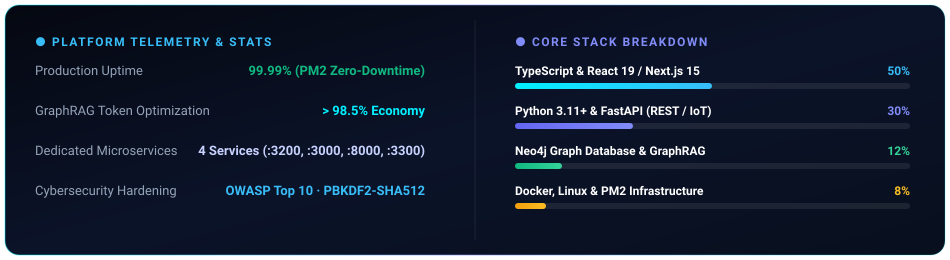

 

  
  
  
  

---

### 🌟 Trayectoria de Vida, Resiliencia & Visión

> *"Cada etapa de mi vida —desde el rigor técnico de la Mecatrónica y la exigencia de trabajar bajo alta presión en EE.UU., hasta la coordinación de equipos en entornos de alto ritmo— me enseñó que la verdadera ingeniería nace de la constancia, la adaptabilidad y el hambre de superación. Hoy estoy 100% enfocado en el desarrollo de software y arquitecturas de Inteligencia Artificial, convencido de que la vida está llena de oportunidades para quienes no temen salir de su zona de confort y dar siempre la milla extra."*
> 
> — **Christian Adrián Muñoz Solís**

---

### 🍱 Engineering & Background Bento Grid

<table>
  <tr>
    <td width="55%" valign="top">
      <h4>🎯 Perfil &amp; Liderazgo Técnico</h4>
      

        <b>Christian Adrián Muñoz Solís</b> — Founder &amp; Tech Lead de <b>BalzAI</b>. Estudiante de <b>Ingeniería en Ciencias de la Computación</b> en la Universidad de Cuenca con excelencia académica, y Bachiller Técnico en <b>Mecatrónica Industrial</b> (Abanderado del Pabellón Nacional, GPA 9.6/10).
      

      <ul>
        <li>🎓 <b>Educación Superior:</b> Universidad de Cuenca (2022 - 2027)</li>
        <li>🏅 <b>Distinción:</b> Abanderado del Pabellón Nacional (GPA 9.6/10.0)</li>
        <li>🌎 <b>Idiomas:</b> Español (Nativo) · Inglés (B1 Conversacional &amp; Técnico)</li>
        <li>🚴 <b>Disciplinas &amp; Hobbies:</b> Gym &amp; Fitness, Ciclismo, Lectura, Dibujo y Natación</li>
      </ul>
    </td>
    <td width="45%" valign="top">
      <h4>🌎 Experiencia &amp; Forja Operativa</h4>
      

        Inmersión laboral internacional y local en entornos de alta exigencia, velocidad y trabajo bajo presión que moldearon mi resiliencia:
      

      <ul>
        <li>🇺🇸 <b>EE.UU. (Myrtle Beach, SC):</b> Prep Cook &amp; Line Cook en <i>Margaritaville</i>, <i>Extreme Pizza</i> y <i>Rioz Steakhouse</i>. Adaptación a ritmo acelerado y entorno 100% en inglés.</li>
        <li>🇪🇨 <b>Ecuador:</b> Personal de cocina en <i>McDonald's</i> (Parque de la Madre), logística y transporte en <i>Uncometro S.A.</i> y <i>25 de Julio S.A.</i></li>
      </ul>
    </td>
  </tr>
</table>

---

### 🛠️ Arsenal Tecnológico

#### 🌐 Frontend & Experiencia de Usuario

  

#### ⚙️ Backend, APIs & Lenguajes de Programación

  

#### 🧠 Inteligencia Artificial, Grafos & Bases de Datos

  

  
  
  
  
  

#### 🛡️ DevOps, Sistemas & Control de Versiones

  

---

### 🚀 Ecosistema de Plataformas & Proyectos

<table>
  <tr>
    <td width="50%" valign="top">
      <h4>🌐 <a href="https://github.com/ytAdrianGT/BalzAI">BalzAI Platform</a></h4>
      
Orquestador multi-agente con memoria de grafo relacional en Neo4j y Parquet, reduciendo más del 98% el consumo de tokens en tareas complejas.

      
<code>Next.js 15</code> · <code>FastAPI</code> · <code>Neo4j 5.26</code> · <code>GraphRAG</code>

    </td>
    <td width="50%" valign="top">
      <h4>🏢 <a href="https://github.com/ytAdrianGT/Startup-BalzAI">Startup BalzAI (Producción)</a></h4>
      
Hub central de producción con balanceo de procesos en PM2, arquitectura monorepo desacoplada y despliegue quirúrgico zero-downtime.

      
<code>PM2 Cluster</code> · <code>Microservicios</code> · <code>Zero-Downtime</code> · <code>Docker</code>

    </td>
  </tr>
  <tr>
    <td width="50%" valign="top">
      <h4>🚗 <a href="https://github.com/ytAdrianGT/Startup-BalzAI">FlashPark IoT</a></h4>
      
Plataforma de estacionamientos inteligentes con telemetría en tiempo real, mapas interactivos con Leaflet e ingesta de sensores IoT.

      
<code>React 19</code> · <code>Vite</code> · <code>FastAPI</code> · <code>Leaflet Maps</code>

    </td>
    <td width="50%" valign="top">
      <h4>🏥 <a href="https://github.com/ytAdrianGT/Startup-BalzAI">Dermatología Clínica</a></h4>
      
Sistema clínico de citas médicas y trazabilidad de inventario farmacéutico con transacciones ACID, integridad referencial y RBAC.

      
<code>Next.js 15</code> · <code>App Router</code> · <code>SQLite</code> · <code>RBAC</code>

    </td>
  </tr>
</table>

---

### 📊 Telemetría de Arquitectura & Métricas

---

